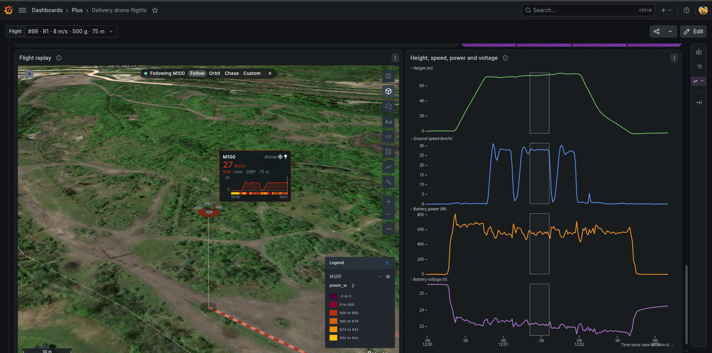
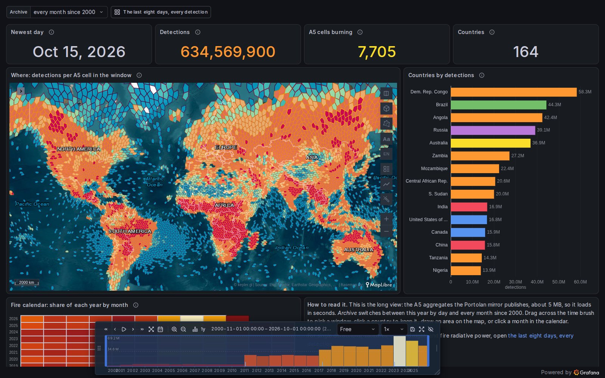
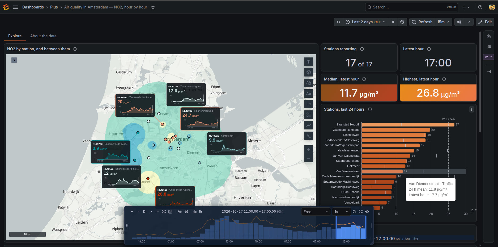
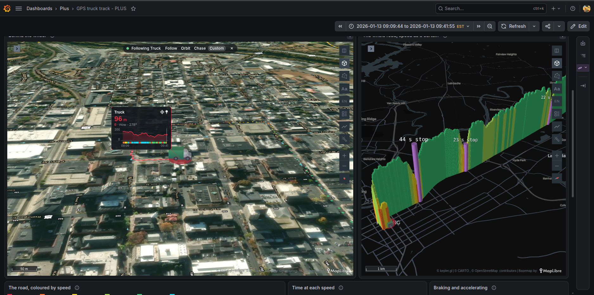

# Chaski

A Grafana app whose datasource loads a dashboard's data **once** into DuckDB running in the browser,
and answers every panel query there. It is named after the runners who carried word along the Andean
roads: the data is already here, so the answer is immediate. Changing a variable, an ad hoc filter or
the time range re-queries the browser, not the server. Filters take milliseconds, and every panel
keeps working: native, catalog and the kepler map.

- **Plugin ids:** the app `ubica-chaski-app` brings the datasource `ubica-chaski-datasource` and the
  panels `ubica-chaski-mosaic-panel` and `ubica-chaski-filters-panel`. Frontend only: no backend, no
  alerting.
- **Mosaic panel:** linked views drawn by [Mosaic](https://idl.uw.edu/mosaic/) on the dashboard's
  datasets. A brush in one filters the others in the browser, pre-aggregated for millions of rows, and
  can write the variables `$__crossfilter` reads. See [docs/mosaic.md](docs/mosaic.md).
- **Filters panel:** a dataset's cross-filters as one panel, with no query to write: how many rows
  they leave, and a Mosaic control for each, counted under the others and following each other live as a
  brush moves (values to pick, a histogram to brush, a text box), in a sidebar or a strip of pills. See [docs/filters.md](docs/filters.md).
- **Engine:** DuckDB 1.4.3 through `@duckdb/duckdb-wasm` 1.32.0, running in a Web Worker.
- **Distribution:** built for the Grafana plugin catalog, Grafana Cloud included (there plugin files
  come from a CDN on another origin). Until it is listed, install a build by hand (see Install).
- **For dashboard authors:** how to write datasets and panel SQL is in [src/README.md](src/README.md). That
  file is the page Grafana shows for the plugin. For a worked example, follow
  [docs/tutorial-earthquakes.md](docs/tutorial-earthquakes.md), which builds a dashboard from a live
  feed three ways: read in the browser, fetched by another datasource, and through the data proxy.
- **Live demos:** [the dashboards tagged `chaski`](https://pacha.ubica.dev/dashboards?tag=chaski) on
  pacha.ubica.dev, open with no account. They run on [Pacha](https://github.com/ubica-ecuador/pacha),
  an open spatio-temporal stack for Grafana that includes Chaski, with DuckDB on the server and the
  kepler map panel: one command brings it up with these dashboards.

## Chaski at work

Four of the live demos, each linked to its dashboard.

[](https://pacha.ubica.dev/d/drone-delivery-flights)

**Delivery drone flights.** Every second of 209 flights loads once into the browser. The Mosaic panel
draws height, speed, power and voltage from it, and its brushes filter the other panels in the
browser, with no query to the server.

[](https://pacha.ubica.dev/d/firms-fire-archive)

**Active fires since 2000.** 634 million satellite detections reach the browser once, as about 5 MB of
aggregates per cell and month. The map, the ranking, the counts and the Mosaic calendar all read it, and
follow the window as it is brushed or played.

[](https://pacha.ubica.dev/d/air-quality-amsterdam)

**Air quality in Amsterdam.** The hourly readings of 17 stations answer every panel in the browser:
moving the hours re-draws the map, the cards and the ranking at once, with no round trip.

[](https://pacha.ubica.dev/d/gps-truck-track-plus)

**A GPS truck track.** One trip's fixes feed two maps, six cards and three Mosaic charts below them,
all from the same dataset in the browser.

## How it works

- **Datasets.** A dataset is a hidden query variable of this datasource. It loads into a versioned
  DuckDB table when the dashboard opens, or on a time-range change if its refresh says so. Panels read it
  by name (`FROM $vehicles`). Its rows come from one of two places:
  - another Grafana datasource (server DuckDB, Postgres, Infinity…), through that datasource's own query
    path;
  - SQL in the browser (`read_parquet`/`read_csv`/`read_json` on a URL that allows CORS, or a `SELECT`
    over another dataset).
- **Files behind Grafana's data proxy.** A server without CORS headers, or one that wants a secret,
  is read through Grafana instead: `$__proxy('path')` builds a URL under
  `/api/datasources/proxy/uid/<uid>/`, and Grafana adds the credentials the datasource stores
  encrypted (basic auth, headers, or a key in the query string). The plugin declares GET and HEAD
  routes for it, so query permission never turns into write access to that server.
- **Range reuse.** A dataset that reloads on time-range change keeps its table when the new range fits
  inside the loaded one, within the same visit to the dashboard, and nothing else in its source changed.
  Refreshing always reloads. The rules this puts on authors are in [src/README.md](src/README.md).
- **Panel queries.** Panel SQL runs locally with the server DuckDB datasource's quoting and macros.
  Around that:
  - each query's column list is remembered, so repeat runs skip the `DESCRIBE`;
  - identical in-flight requests for a panel share one execution;
  - ad hoc filters apply locally.
- **Activity.** The datasource publishes `ubica-duckdbwasm-activity` (`busy`/`settled`) on Grafana's app
  event bus. The kepler panel uses it to pace its playback. The event keeps its old name on purpose:
  the published panel matches it as a string, so renaming it would break playback pacing for anyone
  on the current version.

In development builds (`npm run dev`) and in builds made with `CHASKI_DEBUG=1`, `window.__duckdbwasm`
holds the engine's runner and `stats`, which record every load, reuse, panel answer, shared request and
activity transition on the page. The e2e suite and the bench read it, and it is handy when debugging a
dashboard. Release builds leave it out.

## API for other plugins

Other plugins on the page can use Chaski's engine instead of starting their own DuckDB. The SQLRooms
explorer, the kepler map and this app's Mosaic panel do. They find it at runtime; nothing imports
Chaski's code (the Mosaic panel is a bundle of its own and imports only the API's types).

```ts
const chaski = (window as any).__chaski; // undefined when Chaski is not installed
const api = await chaski?.engine(); // undefined until a Chaski query has started the engine
```

`engine()` never starts the engine itself. While a Chaski query is starting it, `engine()` returns a
pending promise; if that start fails, the promise rejects and `engine()` is `undefined` again.

`apiVersion` is `1`. Additive changes keep it; a breaking change adds `window.__chaski.v2` beside it
for at least one release.

- **`queryIPC(sql, { signal, consumer })`** runs one statement and returns an Arrow IPC stream
  (`Uint8Array`). Decode it with your own apache-arrow: `Table` objects cannot cross bundles, and the
  IPC format is stable across apache-arrow versions.
- **`exec(sql, opts)`** runs statements whose result nobody reads.
- **`consumer`:**
  - `'explorer'` (the default) runs on the explorer's own connections and does not count toward
    `ubica-duckdbwasm-activity`;
  - `'panel'` runs on the panels' path and counts, which is what a panel reading data should use.
    It has no explorer `search_path`: qualify every name (`datasets.sample`, `explore.hot`). An
    unqualified `CREATE TABLE` there would land in `main`, beside the panels' tables. Don't.
- **Extensions:** a statement that needs a shipped extension not loaded yet fails, loads it, and is
  then retried in full. Don't let a multi-statement `exec` script depend on the effects of the
  statements before the one that failed; they run again.
- **`duckdbVersion`** is the engine's DuckDB version, e.g. `v1.4.3`.
- **`datasets()`** lists the dashboard's datasets: name, view, current table, rows, `loadedAt` (when
  that version was loaded, in epoch milliseconds), and `stale` when the latest reload failed.
- **`onChange(listener)`** reports `{kind: 'dataset'}` once a dataset's view reads a new version, and
  `{kind: 'dashboard'}` once another dashboard is on screen. Events arrive in the order the engine
  produced them, so `dashboard` comes before the datasets of that dashboard. A `dataset` event is
  sent only once its view was created; if that fails, the dataset is still readable by its table.
- **`releaseScratch()`** empties `explore`.
- **Leaving for a page without Chaski** (Home, or a dashboard on another datasource) fires no
  `dashboard` event. `datasets()` keeps listing the last Chaski dashboard's datasets, and `explore` is
  kept until another Chaski dashboard comes on screen or `releaseScratch()` is called.

Two schemas go with it:

- **`datasets`:** one view per dataset of the dashboard on screen, e.g. `datasets."sample"`, always on
  the current version. Panel SQL says `$sample` where explorer SQL says `datasets.sample`.
- **`explore`:** scratch space. On explorer connections, unqualified writes land here, and `FROM
sample` finds the dataset. It is emptied when the explorer calls `releaseScratch()` (it should on
  open and on close) and whenever another dashboard comes on screen. Never rely on a table in it
  staying around.

Nothing stops an explicit write to `main`, where the panels' tables live: DuckDB has no
per-connection permissions. Don't. A dropped dataset table breaks its panels until the next refresh.
Scratch tables also share the datasource's memory limit with the datasets.

## Grafana Assistant

On a Grafana with the Grafana Assistant, a Chaski dashboard tells the Assistant which datasets are
loaded in the browser: their `$name`, rows, freshness, columns with DuckDB types, and the time range,
plus two starter questions. Without the Assistant nothing is registered. The Assistant cannot run
Chaski queries (they never reach the server); it writes the SQL for panels. The app registers three
skills with it, for Chaski's SQL, its dataset variables and the Mosaic panel; their texts are in
[docs/grafana-assistant.md](docs/grafana-assistant.md).

## Requirements

- **Grafana 12.0.0 or later** (`grafanaDependency` in `src/plugin.json`). It is tested on 12.0.10
  and 13.2.2.
- **Unsigned builds** (from source, or a release before the catalog signs it): Grafana must allow
  loading the app and the plugins in it, with
  `GF_PLUGINS_ALLOW_LOADING_UNSIGNED_PLUGINS=ubica-chaski-app,ubica-chaski-datasource,ubica-chaski-mosaic-panel,ubica-chaski-filters-panel`.
- **Browser memory.** Each viewer's browser holds the datasets. The limit is a datasource setting
  (`memoryLimitMB`, 1024 by default). Aggregate on the server, and let only the working set reach the
  browser.
- **Range reads.** By default the engine downloads each remote file whole. The `rangeReads` setting
  (off by default) makes it fetch only the parts of a Parquet file a query needs, with HTTP range
  requests. Those requests go one after another, so it pays off on a narrow slice of a large file and
  loses when a dataset reads most of one. Measured on a 40 Mbit/s link:
  - a 12-hour window of 8 days of fires, from a file sorted by time: 1.6 s instead of 8.2 s;
  - the same window from the same rows unsorted: no faster, because every row group spans the whole
    week;
  - a dataset that reads most columns of a 98 MB file: 30 s instead of 24 s.

  For time series in a bucket, write files of a month or a year, each sorted by its time column with
  row groups of about 100,000 rows, and build the file URLs from the time range in SQL: the browser
  cannot list a bucket, so `year=*/…` globs do not expand. A server that ignores ranges still gets a
  full read. The engine is one per page, so the first Chaski datasource a page uses sets this (and
  the memory limit) for the page.

- **Extensions.** The engine loads only the extensions the plugin ships (`parquet`, `json`, `httpfs`,
  `icu`, `spatial`), from its own folder, and only those signed by DuckDB.
  - Once it has started, its configuration is locked (`lock_configuration`): SQL in a dashboard cannot
    change a setting, such as the extension repository or the memory limit. `SET VARIABLE`, `USE` and
    `SET search_path` still work.
  - `INSTALL … FROM` another repository and `LOAD` on a URL fail: the engine's worker refuses extension
    code from anywhere but the plugin's folder. Such an `INSTALL` also leaves that extension pointing
    at the other repository, so it no longer loads on that page until it is reloaded.
- **Grafana's own address.** The browser sends the viewer's session with every request to Grafana's
  origin, so SQL may read only two things there: the plugin's files and the data proxy routes of
  Chaski datasources (`$__proxy`). Grafana's API, its pages and other datasources' proxies are refused.
  - A file served on the same host name as Grafana, beside it (a reverse proxy's `/data/`), is refused
    too. Serve it from another host name, or point a Chaski datasource's proxy URL at it.
  - Grafana lists its datasources when the page loads: a Chaski datasource added since reaches its
    proxy once the page reloads.
- **SQL only reads.** The engine sends GET and HEAD requests only: `COPY … TO` a URL, and S3 writes
  pointed elsewhere by `CREATE SECRET`, are refused.
- **Mosaic panels stay in their panel.** Links a spec draws (a mark's `href`) go through Grafana's URL
  sanitizer, so a `javascript:` link becomes `about:blank`, and a spec's `style` cannot lay a plot over
  Grafana: the panel contains what it paints.
- **Content Security Policy.**
  - The engine starts under Grafana's stock policy with nothing extra to allow.
  - Where Grafana serves plugin files from a CDN on another origin, as Grafana Cloud does, the
    engine's worker starts from a `blob:` URL. A policy that sets `worker-src` must then allow
    `blob:`. Grafana Cloud's own policy only sets `script-src`, and the engine starts under it.
  - A browser-side read of another host needs that host to send CORS headers. If CSP is on, the host
    also has to be in `connect-src`. Otherwise read it through the data proxy (`$__proxy`), which is
    same-origin, or through a server datasource.

## Install (self-hosted)

1. Build it: `npm ci && npm run build`. This writes `dist/`, including the DuckDB worker, the wasm and
   the extensions.
2. Put `dist/` in Grafana's plugin directory as `ubica-chaski-app/`, either copied or mounted. From
   1.x, remove the old `ubica-chaski-datasource/` folder first: Grafana refuses a plugin id it already
   registered, and the app brings the datasource under that same id.
3. Allow the unsigned plugins (see Requirements) and restart Grafana. The app enables itself
   (`autoEnabled`). Changes to any `plugin.json` also need a restart; a rebuilt `dist/` is picked up
   on the next page load.
4. Provision the datasource, as in [provisioning/datasources/datasources.yml](provisioning/datasources/datasources.yml):

   ```yaml
   apiVersion: 1
   datasources:
     - name: 'Chaski'
       uid: 'duckdbwasm'
       type: 'ubica-chaski-datasource'
       access: proxy
       jsonData:
         memoryLimitMB: 1024
         rangeReads: false
   ```

## Develop

You need Node 22 or later, and Docker for the dev Grafana.

```bash
npm ci
npm run dev        # webpack in watch mode
npm run build      # production build into dist/ (CHASKI_DEBUG=1 adds window.__duckdbwasm)
npm run server     # dev Grafana on :3005, the CDN Grafana on :3007, the fixtures server on :8095
```

- `prebuild`/`predev` run `scripts/fetch-duckdb-extensions.mjs`. It downloads `parquet`, `json`,
  `httpfs` and `spatial` for the DuckDB version stated in `src/engine/duckdbVersion.ts`. The plugin serves
  them itself, because it cannot load code from a CDN. When bumping `@duckdb/duckdb-wasm`, bump that
  version too.
- **The dev Grafana** runs **12.0.10** by default, the floor of the supported range. Choose another version
  with `GRAFANA_VERSION=13.2.1 npm run server`. `docker compose --profile csp up` adds a Grafana with the
  stock CSP on **:3006**.
- **The CDN Grafana** on **:3007** serves the plugin the way Grafana Cloud does: its files come from a
  plugin CDN on :8096 (`plugin-cdn/`), under Cloud's CSP. `tests/cdn.spec.ts` runs there.
- **The fixtures server** on :8095 serves `fixtures/` with open CORS, the way a public bucket would.
  `scripts/make-fixture.py` regenerates `sample.parquet`.
- Use webpack and the configuration in `.config/`. Don't edit anything under `.config/`; extend it
  instead (`webpack.config.ts`).

### Layout

| Path                               | Role                                                                                                                                                                                                                                                                                                                                                                                                                                       |
| ---------------------------------- | ------------------------------------------------------------------------------------------------------------------------------------------------------------------------------------------------------------------------------------------------------------------------------------------------------------------------------------------------------------------------------------------------------------------------------------------ |
| `src/engine/`                      | The engine. It has no Grafana imports (`@grafana/*` is forbidden there by ESLint). It holds the DuckDB runner, the dataset registry and its visits, the range-reuse rule (`rangeReuse.ts`), panel execution with the schema cache (`executor.ts`, `schemaCache.ts`), `singleFlight.ts`, `activity.ts`, macros and quoting, and `stats.ts`.                                                                                                 |
| `src/grafana/`                     | The Grafana side: the engine singleton, interpolation, Arrow ⇄ DataFrame conversion, loading from other datasources, dashboard keys and navigation, the data proxy (`proxy.ts`: base URL, routes, error explanations), the activity event, and notices.                                                                                                                                                                                    |
| `src/assistant/`                   | The Grafana Assistant support: the datasets digest, its page-context registration scoped to the dashboard, the live controller fed by the engine API, and the exported skill texts.                                                                                                                                                                                                                                                        |
| `src/plugin.json`, `src/module.ts` | The app: it has no pages, and brings the plugins in `src/plugins/`.                                                                                                                                                                                                                                                                                                                                                                        |
| `src/plugins/`                     | Each nested plugin's `plugin.json`, `module.ts` and logo: `datasource/`, `mosaic/` and `filters/`. The build writes each to `dist/plugins/<name>/`, which Grafana serves under the plugin's own id (13) or inside the app's folder (12), so everything a plugin loads by URL sits beside its module: the DuckDB worker, wasm and extensions in `dist/plugins/datasource/`. No plugin may split off a lazy chunk (see `webpack.config.ts`). |
| `src/filters/`                     | The filters panel: the declarations read from the dashboard, the Mosaic specs made from them, and the sync between its controls and the variables.                                                                                                                                                                                                                                                                                         |
| `src/mosaic/`                      | The Mosaic panel: the connector on the engine API, the params shared by a dashboard's panels, spec sizing, and the variables a selection writes.                                                                                                                                                                                                                                                                                           |
| `src/datasource.ts`                | `DataSourceApi`: panel queries, dataset and values variables, ad hoc filter options.                                                                                                                                                                                                                                                                                                                                                       |
| `src/components/`                  | The config, query and variable editors.                                                                                                                                                                                                                                                                                                                                                                                                    |
| `tests/`                           | End-to-end tests (`@grafana/plugin-e2e`).                                                                                                                                                                                                                                                                                                                                                                                                  |
| `fixtures/`                        | What the fixtures server serves: `sample.parquet`, plus three locations that send no CORS headers and want a bearer token, basic auth or a key in the URL — what the data proxy tests read through.                                                                                                                                                                                                                                        |
| `provisioning/`                    | The dev Grafana's datasources and dashboards (`e2e`, `e2e-range`, `e2e-proxy`, `bench-1m`, `mosaic`, `mosaic-states` for the Mosaic panel, and `chaski-filters` for the filters panel). Besides the plain instance it provisions four that read through the data proxy, one per way in plus one with a wrong token.                                                                                                                        |
| `plugin-cdn/`                      | The CDN Grafana's settings and the nginx that plays the plugin CDN, so that one Grafana serves the plugin the way Grafana Cloud does.                                                                                                                                                                                                                                                                                                      |
| `examples/`                        | Example dashboards for Grafana 13 (see [examples/README.md](examples/README.md)), synced into Pacha by Git Sync; `scripts/load-examples.mjs` loads them into a dev Grafana.                                                                                                                                                                                                                                                                |
| `bench/`                           | Measurement scripts and bench dashboards (see Bench).                                                                                                                                                                                                                                                                                                                                                                                      |

## Test

```bash
npm run test:ci    # Jest; engine tests run on DuckDB's Node build
npm run typecheck
npm run lint
npm run e2e        # Playwright against the dev Grafana (CHASKI_DEBUG=1 npm run build, npm run server first)
```

- The e2e tests default to `http://localhost:3005`. Point them elsewhere with `GRAFANA_URL`.
  `tests/cdn.spec.ts` runs on the CDN Grafana instead, `http://localhost:3007` or `GRAFANA_CDN_URL`.
- Run them on both ends of the supported range: the default 12.0.10, and 13.2.1 with `GRAFANA_VERSION`.
- They cover:
  - loading a dataset and filtering without network requests;
  - ad hoc filters;
  - keeping the last good data when a reload fails;
  - range reuse, including a dataset loaded through another datasource;
  - reading files through the data proxy behind a token, basic auth and a key in the URL, plus the
    messages a rejected credential and a direct read without CORS produce;
  - the engine API: a dataset read by name, a scratch table, and explore emptied on a dashboard change;
  - Save & test;
  - the engine and the spatial extension starting from a plugin CDN, as on Grafana Cloud;
  - the locked configuration, an extension refused from another origin, and Grafana's API out of
    reach, also from a CDN;
  - the Mosaic panel: a brush filtering the other Mosaic panels and, through the variables it writes,
    a Chaski table; and its empty, waiting and error states;
  - the filters panel: picking a value, brushing a histogram and typing a search set their variables,
    a chip's × in another filters panel clears a brush, a Mosaic panel on the same selection drives it,
    every count follows, and Clear all empties them;
  - with `EXAMPLES=1`, on Grafana 13 and with the network: every tab of the examples' gallery, and a
    brush driving its stat panels.

## Bench

The scripts in `bench/` drive a real Chromium through Playwright and print one JSON report per run.
Results go to `bench/results/`, which git ignores.

| Script                 | Measures                                                                                                                                                                                                                                             |
| ---------------------- | ---------------------------------------------------------------------------------------------------------------------------------------------------------------------------------------------------------------------------------------------------- |
| `measure.mjs`          | Cold and warm load, memory, filter latency, auto-refresh reloads, and range reuse on zoom-in/zoom-out (`--zoom`/`--unzoom`).                                                                                                                         |
| `playback.mjs`         | Whether the panels following kepler's time slider keep up while it plays: the share of publishes answered before the next one, publish-to-answer latency (also per panel), dropped frames and long tasks. It uses hardware GL and a narrowed window. |
| `playbackMetrics.mjs`  | The arithmetic behind `playback.mjs`. Test it with `node --test bench/playbackMetrics.test.mjs`.                                                                                                                                                     |
| `setup-bench.mjs`      | Registers the datasource and uploads the bench dashboards: `bench-1m`, `--with-gtfs`, `--with-earthquakes`.                                                                                                                                          |
| `make-earthquakes.mjs` | Regenerates `earthquakes-local`/`earthquakes-server` from kepler-grafana's `earthquakes` dashboard.                                                                                                                                                  |

`grafana-sources.override.yaml` mounts this plugin into kepler-grafana's :3002 bench. That checkout is
often shared with other work, so check that its `dist/` is the build you mean to measure before you
trust the numbers. The scripts read `window.__duckdbwasm`, so measure a `CHASKI_DEBUG=1` build.

## Changelog and license

- Changes: [CHANGELOG.md](CHANGELOG.md).
- License: Apache-2.0 ([LICENSE](LICENSE)).
- Trademarks: Chaski is an independent project, not affiliated with or endorsed by the DuckDB
  Foundation. DuckDB is a trademark of the DuckDB Foundation.
